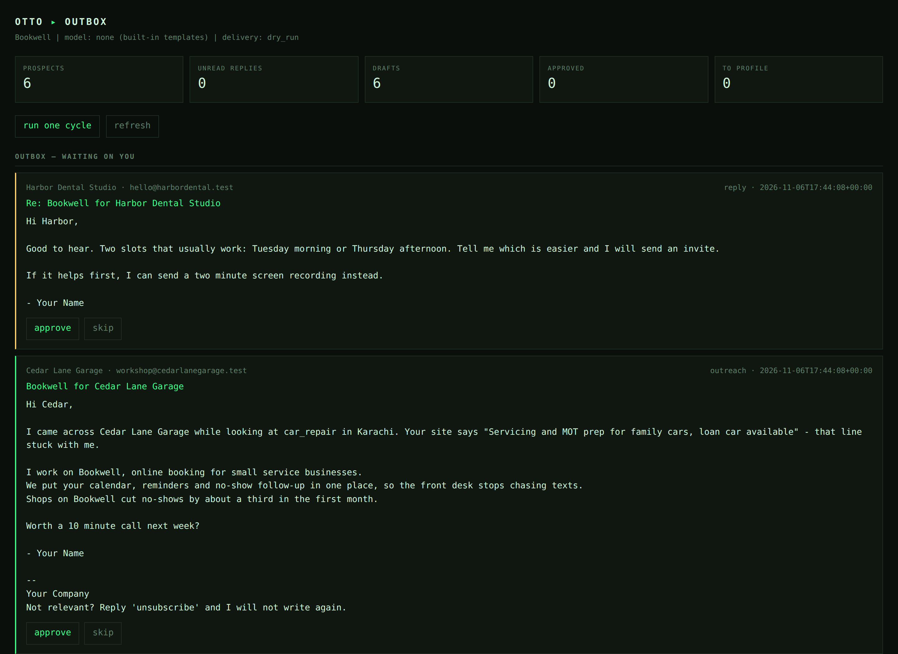

# otto

```
 ___  _  _
/ _ \| |_| |_ ___
\___/ \__|_| \___|   always be closing, never be billed
```

**[Live site](https://muhammadabubakar69.github.io/otto/)** ·
[CI](https://github.com/MuhammadAbuBakar69/otto/actions/workflows/ci.yml) ·
[License: MIT](https://github.com/MuhammadAbuBakar69/otto/blob/main/LICENSE)

The site has a **working demo**: it runs a JavaScript port of the pipeline in your
browser, and a test asserts its drafts are byte-identical to the Python ones.

**An autonomous outreach agent with a $0 model bill.** No API keys, no
subscriptions, no accounts, no free trial that expires.

Otto finds businesses worth talking to, reads their website, writes an email that
mentions something true about them, queues it for your approval, sends it from
your own mailbox, reads the replies, and drafts the answers. It runs on your
machine in a loop.

Harvey proved the shape of this product. Otto's argument is one step further:
you should not have to rent a Claude or ChatGPT plan to run an agent on your own
laptop. The agent is Python, the store is SQLite, the model is optional, the bill
is zero.

```
$ python -m otto run

==============================================================
Otto is online. Model: none (built-in templates). Delivery: dry_run.
==============================================================

[09:15:00] cycle
  handler  -> 1 answer(s) drafted for approval
  writer   -> 3 draft(s) waiting for you
  reader   -> 5 site(s) read, $0
  decision -> handle_replies
  sleeping 900s. Ctrl-C to stop.
```

---

## What it costs

| | |
|---|---|
| The agent | $0, MIT, `git clone` |
| Finding businesses | **$0** — a CSV you write, or OpenStreetMap/Overpass (no key) |
| Reading their website | **$0** — three HTTP requests, no model call |
| Deciding what to do next | **$0** — four SQL counts |
| Sorting replies | **$0** — keyword rules |
| Writing the email | **$0** — built-in templates, or a model you already run locally |
| Sending | your own mailbox (Gmail app password works, ~$0) |
| Everything else | $0 |

There is no third provider option on purpose. If it needs a key or a card, Otto
does not call it.

## Why this is fast to run

- **Zero dependencies.** Standard library only. No `pip install`, no lockfile,
  no Docker required, no build step.
- **One file of state.** SQLite at `data/otto.db`. Copy it, back it up, delete it.
- **Safe by default.** `delivery.mode = "dry_run"` means nothing leaves your
  machine until you change one line and add a mailbox.
- **Ten-second demo.** `python -m otto demo` invents six businesses on `.test`
  domains and fills the outbox. No network, no credentials.

## Quick start

```bash
git clone https://github.com/MuhammadAbuBakar69/otto.git
cd otto
python3 -m otto demo          # six invented prospects, six drafts, two replies
python3 -m otto dashboard     # http://127.0.0.1:5555
```

That is the whole install. Python 3.9+ and nothing else.

When the demo makes sense, point it at real businesses:

```bash
python3 -m otto init                        # writes otto.json
$EDITOR otto.json                           # your product, your name, your address
python3 -m otto discover --source osm --city Karachi --category dentist
python3 -m otto run --once                  # one cycle: read sites, draft, queue
python3 -m otto dashboard                   # approve what you like
```

### Turning on real sending (still free)

```bash
cp .env.example .env
# OTTO_SMTP_USER=you@gmail.com
# OTTO_SMTP_PASSWORD=<a Google app password, not your login>
OTTO_DELIVERY_MODE=smtp python3 -m otto send
```

Otto refuses to send if `sender.postal_address` is empty or the SMTP credentials
are missing. That is not politeness, it is the law in most places.

### Using a local model instead of the templates

Any Ollama install works. There is no key, and no per-token bill because the
model is on your disk.

```bash
ollama pull llama3.2
python3 -m otto doctor                 # model online: yes
OTTO_MODEL_PROVIDER=ollama python3 -m otto write
```

If the model is down, slow, or writes something unusable, Otto silently falls
back to the template. The pipeline never blocks on a model.

## The heartbeat

Wake up, count four things, do the most important one, log it, sleep.

```
            ┌──────────────────────────────────────────────┐
            ↓                                              │
  Wake → Decide → Act → Log → Sleep (default 900s) ────────┘
```

| priority | action | trigger |
|---|---|---|
| 1 | `handle_replies` | replies not yet answered |
| 2 | `send` | drafts you approved |
| 3 | `write` | profiled prospects with no draft, under the daily cap |
| 4 | `profile` | prospects whose site has not been read |
| 5 | `idle` | nothing to do |

The decision is `pipeline.decide()` and it is four SQL counts in `db.py`. Asking
a model "what should I do next?" would spend money to answer a question that
`SELECT COUNT(*)` already answers.

## The outbox

Nothing sends without you. Drafts sit at `status = 'draft'` until you press
approve in the dashboard (or `status` flips to `approved` in SQL). Approving is
the only thing that lets a message into `send_approved()`.



Replies get the same treatment: Otto classifies them, drafts an answer, and waits.
An opt-out does not wait for anything: it marks the prospect `opted_out`,
cancels their pending drafts, and blocks every future send to them.

## Project structure

```
otto/
├── config.py      otto.json + .env, dotted access, no YAML
├── db.py          sqlite schema, counts, the whole state
├── model.py       "none" (templates) or "ollama" (local). Nothing else.
├── profile.py     fetch 3 pages, pull title/description/headings/emails
├── discover.py    prospects.csv or OpenStreetMap/Overpass
├── write.py       prompt + template + the fallback rules
├── send.py        SMTP, dry-run, the compliance gate
├── replies.py     IMAP, keyword classification, reply drafts
├── pipeline.py    the heartbeat and its priority order
├── dashboard.py   one page, stdlib http.server, 127.0.0.1 only
├── demo.py        six invented businesses, zero network
└── cli.py         init, doctor, status, demo, discover, profile,
                   write, send, run, dashboard, reset

site/              the landing page and the in-browser demo
├── index.html     one page, semantic, no framework
├── assets/styles.css
├── assets/engine.js   the pipeline ported to plain JS (used by the demo)
├── assets/demo.js     the demo UI
└── assets/site.js     header, copy buttons, the small stuff

tests/site/        node --test: the JS engine, including Python parity
```

About 2,000 lines of standard-library Python, dashboard page included. Every
module is one idea and can be replaced without touching the rest.

To regenerate that screenshot after changing the dashboard:

```bash
pip install playwright && python -m playwright install chromium
python scripts/screenshot.py
```

That is the only install in the repo, and only for whoever is taking pictures.
Otto itself never needs it.

## Commands

```
python3 -m otto init              write otto.json
python3 -m otto doctor            check the install before a real run
python3 -m otto demo              invented data, no network
python3 -m otto discover          find prospects (csv | osm)
python3 -m otto profile           read prospect websites
python3 -m otto write             draft for profiled prospects
python3 -m otto send              send approved drafts
python3 -m otto run [--once]      the heartbeat loop
python3 -m otto dashboard         local outbox UI
python3 -m otto status            counts and recent events
python3 -m otto reset --yes       delete the local database
```

## Rules Otto plays by

- One email per prospect unless they reply. No sequences, no drip.
- Every message carries an opt-out line and a postal address.
- An opt-out is permanent, respected before sending, and cancels queued drafts.
- Daily caps on drafting and sending, in `otto.json`.
- Small businesses only. There is no bulk spinner because bulk is the thing that
  gives this category a bad name.
- Check the anti-spam law where you and your prospects live. Otto enforces the
  basics; it cannot give you permission.

## Tests

```bash
python3 -m unittest discover -s tests -v     # 31 tests, no network
node --test tests/site/                      # 9 tests, includes parity
```

Or with the Makefile:

```bash
make demo     # seed and print the outbox
make test     # full suite
make lint     # ruff, if installed
make docker   # run it in a container
```

## Docker (optional)

```bash
docker build -t otto .
docker run --rm -p 127.0.0.1:5555:5555 -v "$PWD/data:/app/data" otto demo
```

The image is `python:3.12-slim`, installs nothing, and copies the source. There
is no dependency to cache.

## License

MIT. Take it, change it, sell the service, keep the copyright notice.
